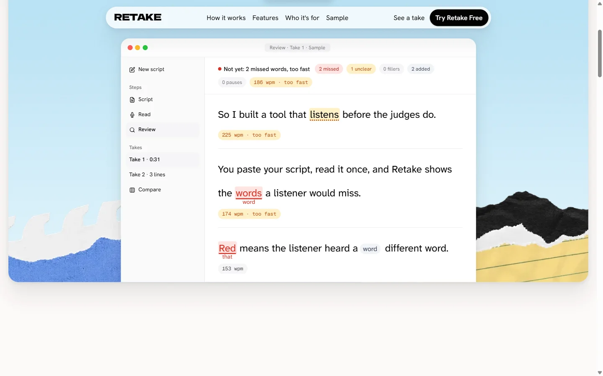
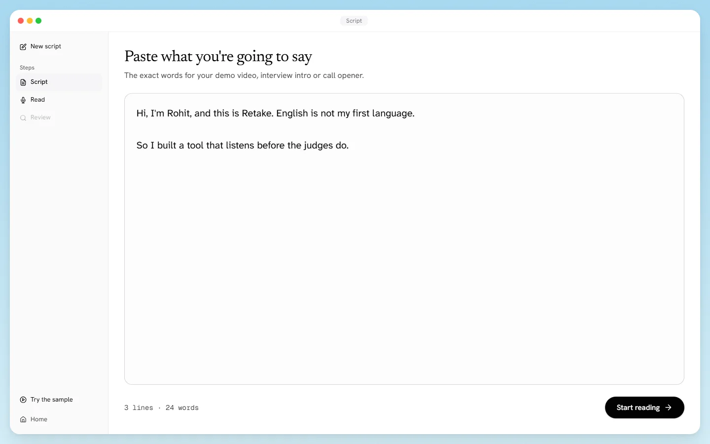
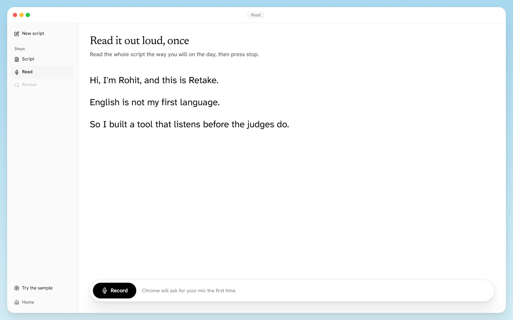
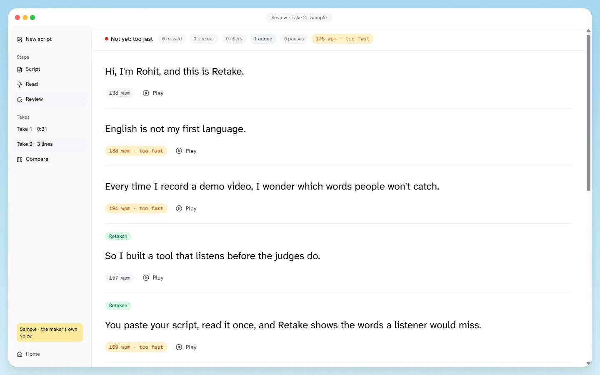
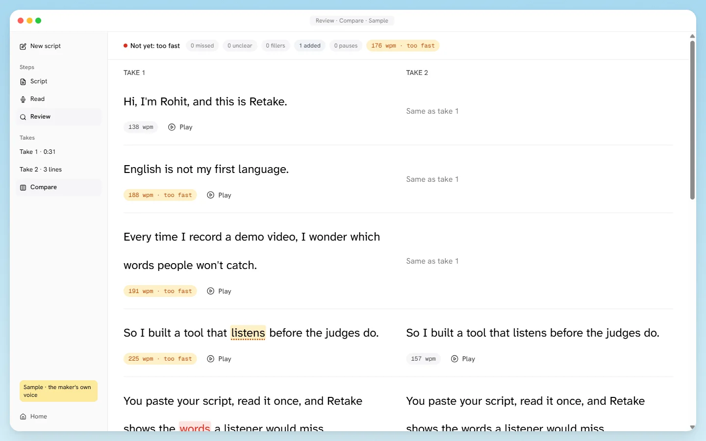
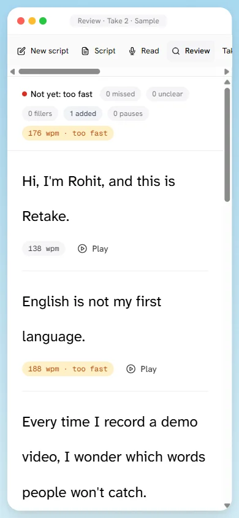

<div align="center">

# Retake

**Hear what a listener would miss, before you hit record.**

Practise the exact words you have to say in English. Read your script once, see which words didn't land,
and retake only those lines.

[**Try it live**](https://retake-gules.vercel.app) · [**Open a real marked take**](https://retake-gules.vercel.app/practice?sample) (no mic, no sign-up) · [How it works](#how-it-works) · [Run it locally](#run-it-locally)



</div>

---

## Why Retake exists

English is my second language. I record every hackathon demo myself, and I prepare for job interviews by saying my
intro out loud. Every time, the same question: *which of my words won't people catch?*

Watching the recording back doesn't help much. I know what I meant to say, so I hear it. A stranger only gets the sound.

A speech-to-text engine is that stranger. If it hears "pillers" when I said "fillers", a person watching my video
probably will too. Retake turns that into a practice loop: read once, see the words that didn't land, fix just those
lines, and record the real thing when the marks are gone.

## What you get

- **Missed words in red.** The listener heard a different word, or nothing at all. The heard word is shown right under
  yours, so you know what came across.
- **Unclear words in amber.** Heard, but the listener wasn't sure.
- **Fillers and extra words** as small chips in the exact spot you said them: "um", "so basically", "you know", repeats.
- **Long pauses** inside a sentence, with their length.
- **Speaking speed** for every line and for the whole take.
- **Click any word to hear it** from your own recording.
- **Retake one line, not the whole thing.** The new line replaces the old one; everything else stays.
- **Compare take 1 and take 2** side by side, and a clear **Ready to record** when nothing important is left.
- **No account.** Your script and marks stay in your browser.

## How it works

| 1. Paste your script | 2. Read it once |
| :--- | :--- |
|  |  |
| The exact words you plan to say: a demo video, an interview intro, a call opener. | Press record and read it out loud in Chrome, the way you will on the day. |

| 3. See what was missed, retake those lines | 4. Compare and get ready |
| :--- | :--- |
|  |  |
| Every marked line has its own Retake button. Retaken lines are labelled. | Take 1 next to take 2. When the marks are gone, you're ready to record. |

It works on a phone too:



## Try it

- **Live:** https://retake-gules.vercel.app, then press **Try Retake Free**. Chrome on a laptop works best.
- **Sample:** [a real marked take](https://retake-gules.vercel.app/practice?sample) of my own voice: take 1 with its
  marks, then three retaken lines. It needs no microphone and makes no calls.

## Under the hood

Retake is one Next.js app and one small API route.

1. **Recording.** The browser's `MediaRecorder` records your take as WebM/Opus at 32 kbps (about 1 MB for 4 minutes).
2. **Listening.** `/api/listen` forwards the audio to [Deepgram](https://developers.deepgram.com/docs/pre-recorded-audio)
   (`nova-3`, `filler_words=true`) and returns each word it heard with its start time, end time and confidence. The
   API key stays on the server.
   - `smart_format` is **off** on purpose, because it rewrites spoken words. Script numbers are spelled out instead ("3" is
     compared as "three").
   - Keyword boosting with your script is **off** on purpose, because it would make the listener hear what it was told to expect.
3. **Lining up the words** ([`lib/align.ts`](lib/align.ts)). This is a word-level edit distance: it finds the cheapest way to
   turn your script into what was heard using keep, swap, missed and added steps, then walks back through the table.
4. **Marking** ([`lib/marks.ts`](lib/marks.ts)).

| Mark | Rule |
| --- | --- |
| Missed | the word was not heard, or a different word was heard |
| Unclear | heard correctly, confidence below 0.65 |
| Filler | an added "uh", "um", "basically", "you know"… that is not in your script |
| Long pause | a gap of 1.2 s or more inside a sentence |
| Speed | words per minute, counting the short break after each sentence; comfortable is 110–165 |
| Ready | no missed words, no fillers, no long pauses, speed in range |

The thresholds are starting values, tuned on my own takes. British spellings in your script ("grey", "practise") are
matched to the listener's US spelling.

## Run it locally

You need Node.js 22 and a [Deepgram API key](https://console.deepgram.com) (new accounts get free credit).

```bash
git clone <this repo>
cd retake
npm install
cp .env.example .env.local      # then put your key in DEEPGRAM_API_KEY=
npm run dev                     # http://localhost:3000
```

Tests use Node's built-in runner, with no extra libraries:

```bash
npm test
```

## Project layout

```
app/
  page.tsx              landing page (its examples are rendered from the real sample)
  practice/page.tsx     the app: Script → Read → Review
  api/listen/route.ts   audio → Deepgram → heard words
components/             app window, steps, marked line, compare view, recorder hook
lib/                    lines, align, marks, storage, sample (with tests)
public/sample/          the real sample session (Deepgram words + audio)
devpost/                scope, PRD and spec this was built from
```

## Privacy

There's no account and no database. Your script and marks are saved in your browser's local storage, and recordings
stay in memory for the current visit. Audio is only sent to Deepgram to be transcribed.

## What's next

- Tips per missed word: how to say it so it lands.
- A teleprompter that scrolls with your voice.
- Saved history of scripts and takes.
- Practice in other languages.

## How it was built

Retake was built for **[Build With AI: Basics](https://learn-ai-basics.devpost.com/)** with its plan-first skill pack:
an idea and [scope](devpost/scope.md), a [product doc](devpost/prd.md), a [technical spec](devpost/spec.md), then a
[step-by-step build](devpost/checklist.md) where each slice was tested before the next one started. The
[`evidence/`](evidence) folder holds the real API calls and screenshots from each step.

Built with [Next.js](https://nextjs.org), [Deepgram](https://deepgram.com), [Motion](https://motion.dev) and
[Untitled UI icons](https://www.untitledui.com/icons). Landing illustrations were made with ChatGPT image generation.

## License

[MIT](LICENSE) © 2026 Rohit Kashyap
